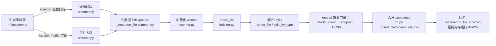
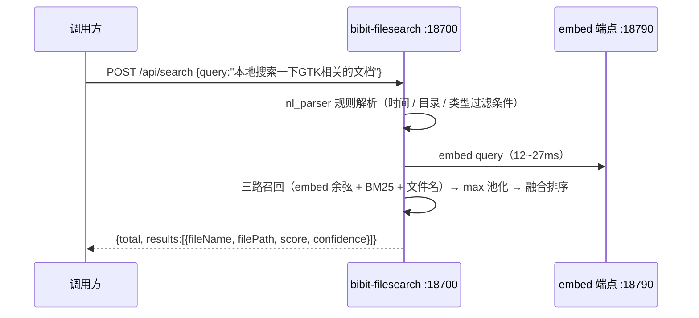

# bibit-filesearch：本地文件检索服务实现介绍

> 面向接入方与二次开发者：本文介绍 bibit-filesearch 的完整实现——服务组成、索引写路径、
> 检索读路径与运维要点。对外 HTTP 契约见 [`api-contract.md`](api-contract.md)，
> 全部配置项见 [`configuration.md`](configuration.md)。
>
> 代码引用只写**文件 / 函数 / 类名**，不标行号——行号会随重构漂移，核对成本高于收益。

## 1. 背景与定位

用户的知识库（`~/Documents`，md/docx/pdf 等）需要被**语义检索**：用自然语言
（如「本地搜索一下 GTK 相关的文档」）就能找到内容相关的文件，而不是只靠文件名。

bibit-filesearch 是这条链路里的**检索数据层**：索引、向量化、语义检索，
对外只暴露一套 HTTP 接口（默认 `:18700`，端口按 uid 派生），独立常驻、不依赖调用方形态。
它可独立部署，也可作为上游的数据层——调用方把一句话递过来，本服务定位到本地文件并回结果。

关键设计原则：

- **独立服务 + per-user 端口**：独立常驻，多用户时端口按 uid 派生（18700 段），互不干扰。
- **向量化是外部依赖，不在本仓实现**：经任意 OpenAI 兼容端点出向量，默认
  `POST http://127.0.0.1:18790/v1/embed/embeddings`，模型 `qwen3-embedding-0.6b-q4_0`
  （Q4_0 量化、1024 维、`--pooling mean`）。**该端点是必需依赖**——缺了检索会报错，
  不会退回纯 BM25（见 README「平台与前提」）。
- **本地优先**：索引、向量、检索全程在本机，用户文档不上传。

## 2. 系统全景

```
┌──────────────────────────────────────────────────────────────────┐
│  调用方（桌面 GUI 插件页 / Agent 上游 / 脚本 / curl）               │
│    │  POST /api/search {query, page, pageSize}                    │
│    ▼                                                              │
│  bibit-filesearch :18700  （数据层：语义检索引擎）                  │
│    │  api/search → nl_parser（规则确定性解析，不调 LLM）            │
│    │             → Retriever（embed 余弦 + BM25 + 文件名 三路融合） │
│    ▼                                                              │
│  返回 { total, results:[{fileName, filePath, score, ...}] }        │
│  依赖：embed 端点（默认 :18790）→ 出 query 与块的向量               │
└──────────────────────────────────────────────────────────────────┘
```

两条使用路径：

1. **界面路径（主）**：桌面 GUI 的「文件检索」插件页（配置 / 状态 / 检索验证），
   直连本服务的 HTTP 接口。
2. **HTTP 路径**：任何调用方把一句话递过来，本服务定位到本地文件并回结果。

## 3. bibit-filesearch 独立服务实现

### 3.1 服务与部署

- **入口**：`python -m bibit_filesearch.main serve --port 18700`
  （main.py；端口默认按 uid 派生，`_port_for_uid` main.py：
  uid<1000 → 18700，uid≥1000 → 18700+(uid-1000)）
- **systemd 单元**：`packaging/bibit-filesearch.service`（**user 单元**，装到
  `/usr/lib/systemd/user/`，由 deb 的 postinst 为**所有登录用户** enable，系统账号除外）。
- **数据目录**：`BIBIT_FILESEARCH_DATA_ROOT` 覆盖，默认 `~/.local/share/bibit-filesearch`
  （main.py）
- **配置目录**：`~/.config/bibit-filesearch/config.yaml`（settings.py
  `_user_config_path`）；config.yaml 单一来源，运行时经 HTTP API 读写

### 3.2 核心组件与组装（main.py create_app，main.py）

组件在 `create_app` 中按固定顺序组装（顺序即依赖关系）：

| 组件 | 类/模块 | 文件 | 职责 |
|---|---|---|---|
| 配置层 | `SettingsService` | settings.py | config.yaml 读写（**单一来源**，无 DB 覆盖）|
| 数据库 | `Database` | db.py | SQLite WAL 两表（files/chunks），线程本地连接 |
| Embed 客户端 | `EmbedClient` | model_client.py | 调 embed 端点（默认 `:18790`）的 `/v1/embed/embeddings` 出向量；`probe_dim()` 探测服务真实维度（**不再信配置值**）|
| 索引器 | `Indexer` | indexer.py | 文件 → 解析 → 分块 → embed → 入库 |
| 检索器 | `Retriever` | retriever.py | 内存向量矩阵 + BM25 双路召回 |
| 扫描器 | `ScanService` | scanner.py | 全盘扫描两阶段状态机 |
| 监听器 | `Watcher` | watcher.py | inotify 增量监听 + 目录补扫 |

组装要点（main.py）：

- **运行时配置先于组件构造**（main.py）：`SettingsService.get_all()` 读
  config.yaml → `config.set()` 合并 → 再构造 scanner/watcher，避免组件拿到空配置
  （否则 `_prune_deleted` 会把索引目录内文件当「移出范围」误删）。
- **回调接线**（main.py）：`indexer.set_on_indexed(retriever.on_file_indexed)`
  / `set_on_deleted` —— 索引完成后增量更新检索内存矩阵。
- **watcher 补扫延迟**（main.py）：`backfill_delay` 等 scanner 首次扫描完成
  再补扫，避免抢 embed 稀缺资源导致向量化超时 failed。
- **启动顺序**（main.py）：先 `reconcile_embed_dim()`（探测 embed 服务真实维度；与存量索引
  不符则清空向量并重排队）→ `watcher.start()` → `scanner.start()` →
  `retriever.warmup()`（预热向量矩阵 + jieba + BM25 倒排）。

### 3.3 数据模型（db.py）

两张表，WAL 模式：

```
files 表（db.py）  文件级元数据
  file_id / path(UNIQUE) / name / file_type / size
  created_at / modified_at / accessed_at / author / directory
  content_hash（增量变更检测） / summary / pdf_images(JSON)
  vectorize_status：queued → vectorizing → completed | failed | unsupported

chunks 表（db.py）  分块级内容与向量
  chunk_id / file_id / chunk_index / text / vector(BLOB，float32 向量，维度随模型)
  UNIQUE(file_id, chunk_index)
```

状态语义（关键）：`unsupported` = 不可索引类型（区别于 completed——检索筛选
`WHERE vectorize_status='completed'` 只把有向量的文件当候选，见 retriever.py；
假 completed 会导致无向量文件被 BM25 召回，见 indexer.py）。

### 3.4 索引写路径（文件 → 可检索数据）



- **扫描两阶段**（scanner.py 注释）：遍历（os.walk，快，入 queued）→ 向量化
  （串行 worker 消费队列，慢）。暂停/继续/状态持久化，重启自动续跑。
- **hash 幂等**（scanner.py, indexer.py）：content_hash 相同跳过重算；
  类型取消（completed 但类型不在 indexable_types）→ 删除回收。
- **unsupported 重启用**（scanner.py）：曾 unsupported 的类型重新勾选 →
  正常入队重新向量化。
- **回收**（api/settings.py `_reconcile_index`）：配置变更（目录/排除/类型）
  后全库核对，只回收有索引状态的文件（completed/queued/vectorizing），unsupported
  保留防「回收→重扫→再回收」循环。
- **并发保护**：`Database._write_lock` 包 replace_chunks 的 DELETE+INSERT（防
  UNIQUE 冲突）；`Retriever._matrix_lock` 串行化内存矩阵更新（watcher/scanner
  多线程回调）。

### 3.5 检索读路径（query → 结果）

`POST /api/search`（api/search.py）→ 请求先经 `parse_nl_query` 规则解析
（api/search.py，时间/目录/类型等结构化条件确定性提取，不调 LLM）→
`Retriever.search`（retriever.py）→ `_do_search`（retriever.py）：

```mermaid
flowchart TD
    Q[query] --> F[SQL 筛选候选文件<br/>_filter_files retriever.py]
    F -->|空 query+filters| R1[纯筛选返回<br/>retriever.py]
    F --> E[query embed]
    F --> B[BM25 稀疏召回<br/>retriever.py]
    E --> C[余弦取候选池<br/>_cosine_aggregate retriever.py<br/>search.candidate_pool，默认 1000]
    C --> P[max 池化→文件级<br/>retriever.py]
    B --> M[合并去重<br/>retriever.py]
    P --> M
    M --> S[语义门槛 min_similarity<br/>retriever.py]
    S --> N[文件名/路径关键词融合<br/>retriever.py]
    N --> S2[BM25 归一化加权 7:3<br/>retriever.py]
    S2 --> C2[排序 → top_k 截断 → 分页<br/>retriever.py]
    C2 --> OUT[results[]: fileId/fileName/filePath/fileType<br/>fileSize/createdAt/modifiedAt/author<br/>score（绝对融合分）/confidence（已归一化）]
```

融合公式（retriever.py）：
`score = 0.538462·S_sem + 0.230769·S_name + 0.230769·S_bm25`（权重和 = 1）。

**两个容易搞混的旋钮**：

| 旋钮 | 作用 | 默认 | 在界面？ |
|---|---|---|---|
| `search.candidate_pool` | 检索深度：取相似度最高的多少个**块**参与聚合 | 1000（0 = 不截断）| ❌ 调试旋钮 |
| `top_k` | 最多**返回**几条（排序后截断的硬上限）| 5 | ✅ 用户设置 |

两者完全解耦：`top_k` 只截断最终返回条数，不影响排序。

### 3.6 API 契约

| 端点 | 方法 | 一句话 |
|---|---|---|
| `/health`、`/health/deep` | GET | 健康检查（深层含 db/embed/索引计数）|
| `/api/search` | POST | 语义检索 |
| `/api/settings` | GET/PUT | 读/写生效配置（PUT 幂等，返回 `data.changed`）|
| `/api/scan`、`/api/scan/progress`、`/api/scan/pause\|resume` | POST/GET | 扫描控制与两阶段进度 |
| `/api/files/{fileId}` | GET | 单文件详情 |

> **权威基准是 [`api-contract.md`](api-contract.md)**——请求/响应字段、错误码、`score` 与
> `confidence` 的语义差异都在那里，本页不复制一份以免漂移。

## 4. 全链路时序（Mermaid）



## 5. 请求与响应示例

```bash
curl -s -X POST http://127.0.0.1:18700/api/search \
  -H 'Content-Type: application/json' \
  -d '{"query":"GTK","page":1,"pageSize":5}'
```

```
{ "code": 0, "message": "ok",
  "data": { "total": 3, "results": [
      { "fileName": "gtk-notes.md",    "score": 0.71, "confidence": 1.0 },
      { "fileName": "gobject-guide.md", "score": 0.63, "confidence": 0.6 } ] } }
```

> `score` 是**绝对分**（三路融合后可超 1）；`confidence` 是 min-max 归一化产物，
> 头名恒 1.0、末名恒 0，**不等于匹配度**。两者的分工与完整字段见 [`api-contract.md`](api-contract.md)。

性能量级：热路径（万块级语料）查询 P95 在十毫秒量级；首次全量索引耗时由 embed 串行决定
（与文件数、块数成正比），此后增量由 watcher 近实时跟进。

## 6. 服务清单与运维

| 项 | 值 |
|---|---|
| 服务 | bibit-filesearch（**user 单元**，装到 `/usr/lib/systemd/user/`）|
| 端口 | 18700 段（uid<1000 → 18700，否则 18700+(uid-1000)）|
| 数据目录 | `~/.local/share/bibit-filesearch`（`BIBIT_FILESEARCH_DATA_ROOT` 可覆盖）|
| 配置 | `~/.config/bibit-filesearch/config.yaml`（**稀疏**：只存与出厂默认不同的键）|
| 依赖 | embed 端点（默认 `:18790`），须先可用 |
| 运维 | `systemctl --user status` / `restart bibit-filesearch`；`journalctl --user -u bibit-filesearch -f` |

健康与验证：

```bash
curl -s http://127.0.0.1:18700/health
curl -s http://127.0.0.1:18700/health/deep          # db / embed / 索引计数
curl -s http://127.0.0.1:18700/api/meta             # uid / home / 派生端口 / OCR 状态
```

已知边界（设计取舍）：

- 索引进度：全量扫描 riscv64 上 300+ 文件约 1 分钟（embed 串行），增量由 watcher 秒级同步；
  数字随知识库规模变化。
- **per-user 单实例**：unit 装为全局、任何登录用户各自拉起一个，端口按 uid 派生，
  多用户同机不冲突；系统账号除外（没有可写的 home 与桌面目录）。
